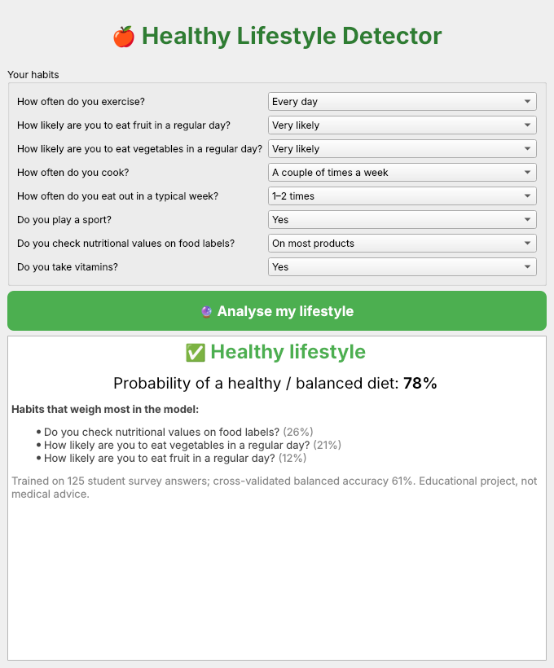

# 🍎 Healthy Lifestyle Detector

A desktop app that estimates whether a person's eating habits look **healthy / balanced**, using a machine-learning model trained on a real student food-habits survey. You answer 8 questions about your habits. The app returns a probability and the habits that weigh most in its decision.



## How it works

1. **Data:** `food_choices.csv` is the *Food choices* survey of 125 college students (61 questions about diet, cooking, exercise and food preferences). Every answer is stored as a numeric code.
2. **Target:** `diet_current_coded == 1`. The dataset authors labelled each student's free-text "describe your current diet" answer; code 1 means *healthy / balanced*. 40% of students have this label.
3. **Features:** 8 lifestyle answers, using the survey's own scales:

   | Feature | Question |
   |---|---|
   | `exercise` | How often do you exercise? |
   | `fruit_day` / `veggies_day` | How likely are you to eat fruit / vegetables in a day? |
   | `cook` | How often do you cook? |
   | `eating_out` | How often do you eat out per week? |
   | `sports` | Do you play a sport? |
   | `nutritional_check` | Do you check nutrition labels? |
   | `vitamins` | Do you take vitamins? |

4. **Model:** Random Forest (300 trees, depth ≤ 4, balanced class weights) with most-frequent imputation for blank answers, in a scikit-learn `Pipeline`.
5. **Evaluation:** repeated stratified 5-fold cross-validation (10 repeats). With only 125 rows, one train/test split would give a very noisy score.

## Results

| Metric (cross-validated) | Random Forest | Always-guess-majority baseline |
|---|---|---|
| Balanced accuracy | **0.61** | 0.50 |
| ROC AUC | **0.70** | 0.50 |
| Accuracy | 0.62 | 0.60 |

Most influential habits: **checking nutrition labels** (26%), **eating vegetables** (21%), **eating fruit** (12%), then eating out, cooking and exercise.

**Honest reading:** the signal is real but modest. 125 survey answers is a small sample, and a self-described "healthy diet" is a noisy label. The app is a learning project in building an end-to-end ML product (data → model → evaluation → UI). It is **not** medical advice.

## Getting started

```bash
git clone https://github.com/YusfAI/healthy-lifestyle-detector.git
cd healthy-lifestyle-detector
python -m venv .venv && source .venv/bin/activate   # Windows: .venv\Scripts\activate
pip install -r requirements.txt

python app.py        # desktop app
python model.py      # print cross-validated metrics + feature importance
pytest               # tests
```

## Project structure

```
├── app.py            # PySide6 desktop UI (training runs in a background QThread)
├── model.py          # data loading, feature definitions, training, evaluation, prediction
├── food_choices.csv  # survey dataset
├── tests/            # pytest: data/scale checks + model sanity checks
└── requirements.txt
```

## Changelog: what was fixed in v2

The first version mapped text values (`"Daily"`, `"Vegan"`, `"Yes"`) onto columns that hold **numeric codes**, so those features were always filled with defaults. Its target also searched for keywords in the free-text answer *"what is a healthy meal?"*, which is an opinion, not the person's habits. As a result the model couldn't learn anything meaningful. v2 uses the survey's real codes, a meaningful target, cross-validation and a Random Forest, and shows which habits drive the prediction.

## Tech stack

Python · pandas · scikit-learn · PySide6 (Qt) · pytest

## Author

**Youssef**, Business Intelligence student at IHEC Carthage · [GitHub](https://github.com/YusfAI)
